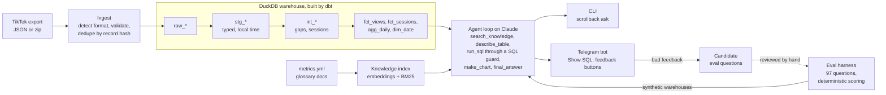

# Scrollback

An LLM data agent over your own TikTok watch history, built on a small but properly modelled
data warehouse and measured by an evaluation harness.

## The problem

TikTok tells you nothing honest about your own usage. Its data export is a raw log of
timestamps and video links. It has no watch durations and no definitions, so it cannot answer
a simple question such as "how much did I actually watch last week?"

Scrollback turns that export into a warehouse with explicitly defined metrics, and puts an LLM
agent on top that answers questions in plain English. The hard part is not the chatbot. It is
making the answers **trustworthy**: consistent metric definitions, refusing questions the data
cannot answer, and an evaluation set that measures accuracy as the agent changes.

## What it does

1. **Ingests** a TikTok JSON export into DuckDB and models it with dbt (raw → staging →
   intermediate → marts), with data-quality tests at every layer.
2. **Estimates watch time** from the gaps between views, a documented method calibrated
   against phone Screen Time, because the export records no durations.
3. **Answers questions** from the command line or a Telegram bot, showing the SQL it ran, the
   metric definitions it used and its assumptions, and refusing what the data cannot support.

<!-- Demo GIF placeholder: docs/demo.gif, recorded on the synthetic sample only (no real data). -->
*Demo GIF to come (recorded on synthetic data).*

## Architecture



- **Warehouse.** DuckDB with dbt-duckdb. The agent may query only the marts, where every
  table and column carries a description.
- **Agent.** A hand-written tool-calling loop on the Anthropic API. Every query passes a
  `sqlglot` guard: read-only, marts only, row limits, and an `aggregate_only` mode that rejects
  row-level results so individual records never reach the model.
- **Knowledge.** Metric definitions (`knowledge/metrics.yml`) and glossary documents are
  indexed locally (fastembed `bge-small-en-v1.5` plus BM25, merged by reciprocal rank fusion)
  and retrieved by the agent on demand.
- **Evaluation.** A versioned question set with gold SQL, deterministic scoring, a bad-case
  taxonomy, and one config change per experiment.

The full specification is in [docs/DESIGN.md](docs/DESIGN.md).

## Estimating watch time without durations

The export records when each view **started**, not how long it lasted. Watch time therefore
has to be estimated, and that estimate is the project's central data definition.

```
time ─▶  v1 ──40 s──▶ v2 ──15 s──▶ v3 ──────245 s──────▶ v4    ···· 45 min, no views ····    v5
est.     40 s         15 s         180 s (capped)         40 s                                 20 s
         └─────────────────── session 1: 275 s ──────────────┘                               └ session 2
```

*Worked example with the evaluation parameters (30-minute session gap, 180-second cap).*

- **Sessions.** Consecutive views belong to one session while the gap between them is at most
  30 minutes. A longer gap starts a new session.
- **Each view** is credited with the gap to the next view, capped at `view_cap_sec`. A long gap
  usually means the person looked away, not that they watched one video for four minutes.
- **The last view of a session** has no next view, so it is credited with the median of the
  other views in its session (40 s above). A session with a single view gets a fixed default.
- **Caveats** the agent states whenever it reports watch time: pauses shorter than the cap
  count as watching, videos longer than the cap are undercounted, and background play is
  invisible.

**Calibration against Screen Time.** The cap was checked against one week of the owner's
iPhone Screen Time for TikTok. With a 180-second cap the estimate came out **4.7% above**
Screen Time; with a 120-second cap, **8.2% below**. Screen Time counts all time spent in the
app, including comments, messages, search and browsing, so a watch-time estimate should sit
somewhat below it, never above. The real configuration therefore uses 120 seconds. The cost of
that choice is that longer videos are undercounted. Screen Time is treated as an upper bound,
not as a target to fit.

| Parameter | Evaluation and synthetic data | Real export (calibrated) |
|---|---|---|
| Session gap (`session_gap_min`) | 30 min | 30 min |
| Cap per view (`view_cap_sec`) | 180 s | 120 s |
| Single-view session default (`default_last_view_sec`) | 20 s | 10 s |
| Binge session threshold (`binge_threshold_min`) | 60 min | 60 min |

The evaluation parameters are pinned in `eval/questions.yaml`, so the gold answers never move
when the real configuration is tuned. The method is written down in
[knowledge/docs/watch_time_estimation.md](knowledge/docs/watch_time_estimation.md), which the
agent retrieves, and in DESIGN §4.3.

## Results

96 evaluation questions (64 development, 32 held-out test), each run three times and scored
deterministically against gold SQL. Development questions were used to iterate; the test split
ran only for the baseline and the final configurations. All data is synthetic.

| Config | Model | What the agent gets | Dev pass rate | Test pass rate | Cost / question |
|---|---|---|---|---|---|
| E-1 | Sonnet 5.5 | Staging views only (no marts) | 51.0% | 59.4% | $0.0097 |
| E0 | Sonnet 5.5 | Marts, schema and `run_sql`, minimal prompt | 91.7% | 96.9% | $0.0097 |
| **E1** | Sonnet 5.5 | E0 + table and column descriptions | **99.5%** | **99.0%** | $0.0105 |
| **E6b** | Haiku 5.5 | E1 + knowledge search, a "look up definitions" rule, refusal and caveat rules, a "what this data can't answer" document | **99.5%** | **100%** | $0.0011 |

1. **The data modelling is worth about 40 points.** E-1 and E0 run the same agent, prompt and
   model; only the tables differ. The marts encode decisions the agent cannot make alone,
   above all how to estimate watch time from view start times.
2. **Descriptions close most of the remaining gap.** Nearly all of E0's failures were one
   definition: session length measured as a clock span rather than estimated watch time.
   Describing the columns fixed it on both models.
3. **Haiku with retrieval and rules matches Sonnet at about a ninth of the cost.** The best
   Haiku configuration is level with Sonnet E1 on development questions and within one run of
   it on the test split.

<details>
<summary>Full experiment ladder, tokens, latency and remaining failures</summary>

Pass rates are the mean over three repeats, with the worst and best repeat in brackets. Each
row is one change from the row above it.

| Config | Model | Change | Dev pass rate | Test pass rate | Cost / question | Tokens / question | Latency |
|---|---|---|---|---|---|---|---|
| E-1 | Sonnet 5.5 | E0, but only the staging views (no marts) | 51.0% (50.0–51.6) | 59.4% | $0.0097¹ | 7,341¹ | 7.0 s¹ |
| E0 | Sonnet 5.5 | baseline: schema + `run_sql`, minimal prompt | 91.7% (90.6–92.2) | 96.9% | $0.0097¹ | 8,663¹ | 6.0 s¹ |
| **E1** | Sonnet 5.5 | + table and column descriptions | **99.5%** (98.4–100) | **99.0%** (96.9–100) | $0.0105 | 9,487 | 6.3 s |
| E0 | Haiku 5.5 | E0 on Haiku | 90.1% (89.1–90.6) | — | $0.0009 | 10,160 | 5.3 s |
| E1 | Haiku 5.5 | + table and column descriptions | 97.9% (95.3–100) | — | $0.0008 | 10,917 | 5.2 s |
| E2a | Haiku 5.5 | + `search_knowledge` (hybrid retrieval over metrics, glossary, tables) | 98.4% (96.9–100) | — | $0.0011 | 14,401 | 5.1 s |
| E2a′ | Haiku 5.5 | E2a re-run after two retrieval fixes | 98.4% (96.9–100) | — | $0.0011 | 14,653 | 5.3 s |
| E2b | Haiku 5.5 | + "look up a metric's definition before computing it" | 99.5% (98.4–100) | — | $0.0010 | 14,431 | 5.3 s |
| E6a | Haiku 5.5 | + caveat, refusal and "unknown isn't zero" rules | 99.0% (98.4–100) | — | $0.0012 | 15,523 | 6.2 s |
| **E6b** | Haiku 5.5 | + the "what this data can't answer" doc in the index | **99.5%** (98.4–100) | **100%** (100–100) | $0.0011 | 15,066 | 6.1 s |

¹ E-1 and E0 on Sonnet ran dev and test together; their efficiency figures are over all 96
questions. Other rows are from the dev run.

E3 (few-shot examples) and E5 (a semantic-layer tool) were skipped because no failures were
left for them to fix after E2b. E4 (richer SQL error messages) was cut because there were no
SQL-error failures.

**What still fails** (owner-confirmed labels; failing runs out of 192 dev or 96 test):

| Config | Dev | Test |
|---|---|---|
| E-1 Sonnet | 94: 45 over-refusal, 40 wrong metric definition, 6 day-boundary, 2 failed refusal, 1 misreport | 39: 25 wrong metric definition, 8 over-refusal, 6 day-boundary |
| E0 Sonnet | 16: 12 wrong metric definition, 3 missing caveat, 1 misreport | 3: wrong metric definition |
| E1 Sonnet | 1: wrong metric definition | 1: missing caveat |
| E0 Haiku | 19: 11 wrong metric definition, 3 aggregation, 3 missing caveat, 2 failed refusal | — |
| E1 Haiku | 4: 2 wrong time window, 1 aggregation, 1 failed refusal | — |
| E6b Haiku | 1: wrong time window ("last weekend" read as the weekend before) | 0 |

</details>

Reports for every run are in [eval/reports/](eval/reports/); the final test runs are in
[eval/reports/final_test.md](eval/reports/final_test.md).

## Three instructive bad cases

**1. Session length measured as a clock span (E0, 15 failing runs).**
- *Symptom.* Asked for the longest or average session, the baseline agent reported the time
  from the first view to the last, for example "the longest session ran about 62 minutes from
  start to end" when its estimated watch time was 34.7 minutes.
- *Cause.* The marts contain the right column, but without a definition the agent led with the
  more obvious reading. It is the one definition that is not visible from column names alone.
- *Fix.* Table and column descriptions in `describe_table` (E1). On Sonnet the five affected
  questions went from 0 of 15 passing runs to 14 of 15 (dev and test combined); on Haiku the
  same change removed every wrong-definition failure.

**2. "0 minutes" for a day with no data (q072, the one failure that persisted on Haiku until E6a).**
- *Symptom.* Asked "how long have I watched TikTok today?" when the export ends yesterday, the
  agent often answered "0 minutes", sometimes right after noting that the export might not
  cover today.
- *Cause.* An empty result was read as zero. A day outside the export is unknown, not a day
  without viewing.
- *Fix.* Two parts. The scoring rule makes the trap explicit: any amount stated for the
  missing day fails, even 0, while "no data for today; yesterday was N minutes" passes. The
  E6a prompt then added refusal-first and "unknown isn't zero" rules, and q072 passed 3 of 3
  runs on Haiku for the first time.

**3. Every weekday one off in the bot's `/week` (found on a phone, now eval question q097).**
- *Symptom.* During the phone check of the Telegram bot, `/week` returned seven correct daily
  totals, each labelled with the wrong weekday (a Saturday shown as "Fri").
- *Cause.* The model worked out weekday names from the dates itself. Calendar arithmetic is a
  known weak spot: the one remaining E6b development failure is a related misreading of "last
  weekend".
- *Fix.* The answer was rated bad in Telegram, which recorded it against its trace;
  `scrollback eval import-feedback` turned it into a candidate question. The bot's `/week`
  request now tells the agent to take weekday names from `dim_date.dow_name`, after which all
  seven labels were right. The case became eval question q097, with every off-by-one label
  listed as a wrong answer. A deterministic date-resolution tool is the general fix and is on
  the stretch backlog.

## Limitations

- **Accuracy is measured on synthetic data only.** Every evaluation run uses the synthetic
  sample and the parameters pinned in `eval/questions.yaml` (180-second cap). The CLI and the
  bot run the same best configuration (Haiku E6b) on the real export with the calibrated
  parameters (120-second cap). Accuracy on real data is not measured; bad answers from the bot
  become candidate eval questions instead.
- **The scorer is pattern-based.** It extracts numbers, units and dates from the answer text
  and matches them against the cells of the gold result and of the SQL results the answer
  cites. It is deterministic and every rule is unit-tested on real answer texts, but unusual
  phrasings can still produce false passes or false failures, so every failure was reviewed by
  hand.
- **The test split is small**: 32 questions, all written by the project's author. A 100% test
  pass rate means "no failures on this set", not "never wrong".
- **q097 has not been run yet.** All reported results are on the 96-question set.
- **Watch time is an estimate.** The calibration covers one week from one phone; the cap is a
  round value below Screen Time, not a fitted one.

## Quickstart (synthetic data)

Requirements: [uv](https://docs.astral.sh/uv/) and, for the agent, an Anthropic API key.
`config.sample.yaml` is `config.yaml` with the evaluation parameters and its own warehouse
file, so the synthetic answers follow the evaluation setup.

```bash
git clone https://github.com/tokyda/scrollback.git
cd scrollback
uv sync

# 1. Regenerate the committed synthetic export (same seed, identical file), then load it.
#    Ingest runs dbt build: models plus data tests.
uv run scrollback synth --config config.sample.yaml
uv run scrollback ingest data/sample/user_data_tiktok.json --config config.sample.yaml

# 2. Ask a question. The synthetic history ends on 2026-11-19, so pin "today" just after it.
cp .env.example .env        # then set ANTHROPIC_API_KEY in .env
uv run scrollback ask "How many minutes did I watch on each day of last week?" \
  --today 2026-11-20 --show-sql --config config.sample.yaml
```

The first question builds the local knowledge index, which downloads a small embedding model
from Hugging Face once (a warning about `HF_TOKEN` can be ignored). A question costs about
$0.001 on the default configuration (Haiku E6b).

**Browse the warehouse.** `uv run scrollback docs --config config.sample.yaml` builds the dbt
documentation site (lineage graph, every model and column description) as one file,
`dbt/target/docs/static_index.html`, to open in a browser.

**Reproduce the headline test numbers.** The eval harness builds its own synthetic
warehouses, so it needs no ingest. Without `--yes` it only prints a cost estimate.

```bash
uv run scrollback eval check-gold                    # gold SQL is valid and unchanged (free)
uv run scrollback eval run --config eval/experiments/e06b_cannot_answer_haiku.yaml \
  --split test --repeat 3                            # prints a cost estimate only
uv run scrollback eval run --config eval/experiments/e06b_cannot_answer_haiku.yaml \
  --split test --repeat 3 --yes                      # runs it
uv run scrollback eval report eval/runs/<run-folder>
```

The final test run of this configuration cost about $0.11. On a fresh clone the printed
estimate is higher, because it is based on the few traces you have so far. Expect results
close to, not identical with, the table above: model outputs vary between runs.

## Telegram bot

The bot answers questions from a phone with the same configuration as `scrollback ask`. It
replies only to chat IDs listed in `TELEGRAM_ALLOWED_CHAT_IDS`, ignores every other chat
silently, and refuses to start unless `aggregate_only` mode is on.

1. Create a bot with Telegram's @BotFather and put its token in `.env` as
   `TELEGRAM_BOT_TOKEN`.
2. Put your chat ID in `.env` as `TELEGRAM_ALLOWED_CHAT_IDS`.
3. Run `uv run scrollback serve bot` and leave it running. Only one instance can poll a token,
   so a second one refuses to start.

| You send | You get |
|---|---|
| any question | the answer, its assumptions and dates, the metrics used, a **Show SQL** button and 👍 / 👎 buttons; a chart if you ask for one |
| `/today` | watch time on the most recent day in the data |
| `/week` | the last seven days of data, by day, with a chart |
| `/metrics` | every metric's definition |
| `/feedback good\|bad [note]` | rates the answer you reply to |

`uv run scrollback eval import-feedback` turns answers rated 👎 into candidate eval questions
in a git-ignored file. Accepted candidates are copied into `eval/questions.yaml` by hand, with
gold SQL written from the metric definitions against synthetic data.

## Privacy

Scrollback runs on one person's viewing history, so the repository is built to hold none of it.

- Real exports live in `data/raw/`, and warehouses, traces, eval runs, charts and feedback
  candidates are all git-ignored. Only the synthetic sample in `data/sample/` is committed, and
  tests, evaluations and CI use only synthetic data.
- Query results are sent to the LLM provider. In `aggregate_only` mode, which the bot
  enforces, the SQL guard rejects row-level results, so only aggregates leave the machine.
- Command output, logs and errors report counts and key names, never records. Bot logs never
  contain question text, answers, chat IDs or the bot token.
- Figures in this README about the real export are percentages from the calibration only.

## Repository guide

- [docs/DESIGN.md](docs/DESIGN.md): the specification and every design decision.
- [docs/ROADMAP.md](docs/ROADMAP.md): build phases and progress.
- [docs/DEMO.md](docs/DEMO.md): the three-minute demo script.
- [eval/](eval/): questions, experiment configs, labels and reports.
- [dbt/](dbt/): the warehouse models and tests.
- [knowledge/](knowledge/): metric definitions and glossary documents the agent retrieves.
